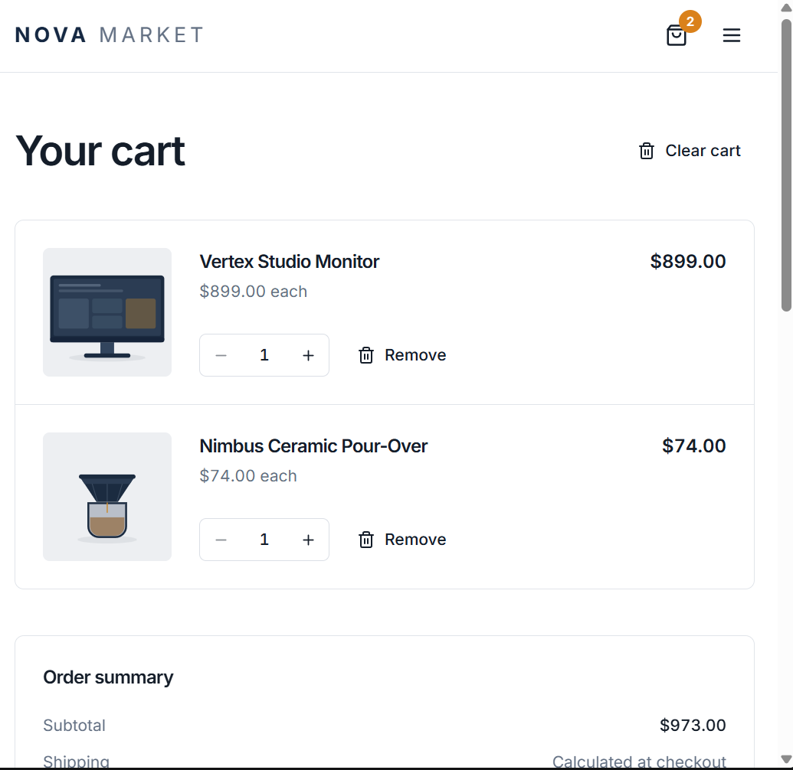
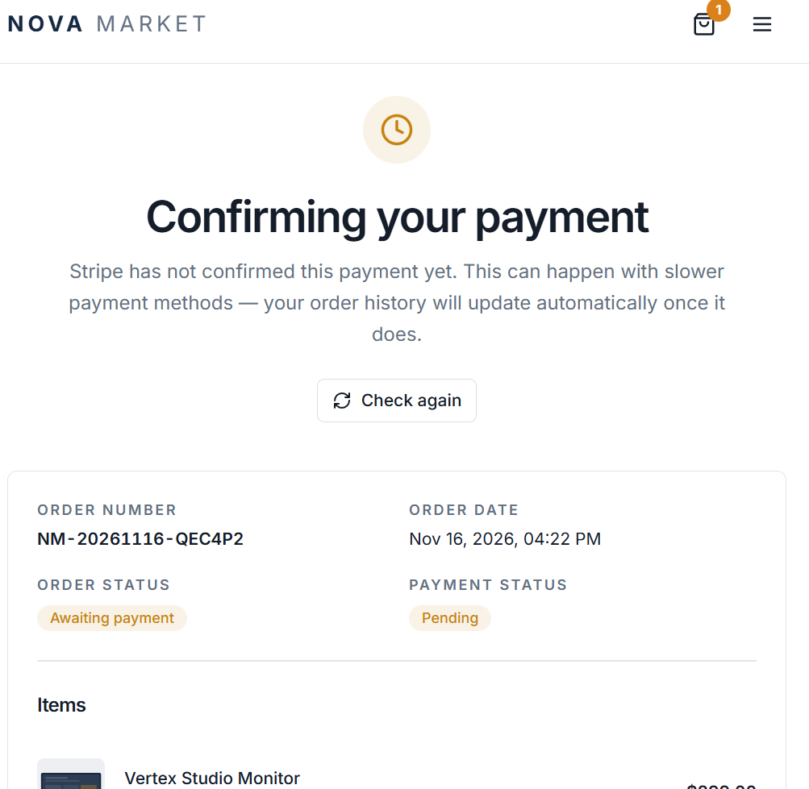
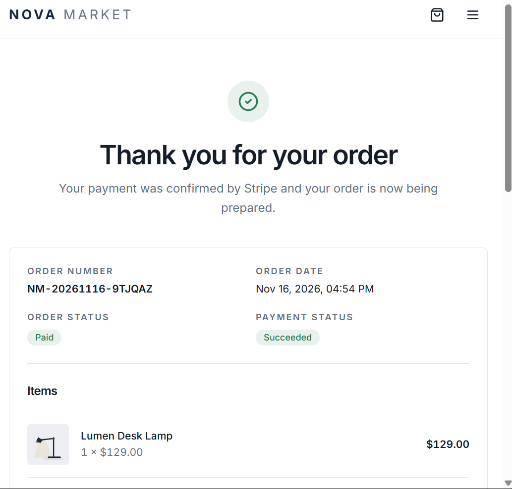

# NOVA MARKET

A full-stack e-commerce application with a complete, correct Stripe Checkout
integration: server-authoritative pricing, signature-verified webhooks, and
idempotent payment processing backed by database constraints.

React 18 + Vite + TypeScript on the front, Express + Prisma + PostgreSQL on the
back, Stripe-hosted Checkout in between. **Stripe test mode only.**

---

## Table of contents

1. [Project overview](#1-project-overview)
2. [Technology stack](#2-technology-stack)
3. [Architecture](#3-architecture)
4. [Features](#4-features)
5. [Installation](#5-installation)
6. [Environment setup](#6-environment-setup)
7. [Database setup and Prisma migrations](#7-database-setup-and-prisma-migrations)
8. [Seed data](#8-seed-data)
9. [Running the application](#9-running-the-application)
10. [Stripe setup](#10-stripe-setup)
11. [Stripe CLI webhook testing](#11-stripe-cli-webhook-testing)
12. [Test execution](#12-test-execution)
13. [API documentation](#13-api-documentation)
14. [Security implementation](#14-security-implementation)
15. [Database schema explanation](#15-database-schema-explanation)
16. [Docker instructions](#16-docker-instructions)
17. [Screenshots](#17-screenshots)
18. [Known limitations](#18-known-limitations)
19. [Deployment](#19-deployment)
20. [Project structure](#20-project-structure)

---

## 1. Project overview

NOVA MARKET is a storefront for a small, deliberate catalogue of audio,
workspace, lighting and home products. A visitor can browse and search the
catalogue, build a cart, register, and pay through Stripe-hosted Checkout. An
administrator can manage products, inspect every order, and read a dashboard
whose revenue figure counts only payments Stripe actually confirmed.

The project is built around one principle: **the client is never trusted with
anything that affects money or access.**

- The browser sends product IDs and quantities. It never sends a price, and the
  server never reads one from a request.
- An order becomes `PAID` only when a Stripe webhook arrives with a valid
  HMAC signature *and* a payment status proving funds were captured.
- Reaching the success page changes nothing. It is a read-only view of
  authoritative server state.
- Every admin capability is enforced server-side; hiding a link in the UI is
  treated as cosmetic, never as a control.

---

## 2. Technology stack

### Frontend

| Concern | Choice |
|---|---|
| Framework | React 18 |
| Build tool | Vite 5 |
| Language | TypeScript (strict) |
| Routing | React Router DOM 6 |
| Styling | Tailwind CSS 3 |
| Components | shadcn/ui pattern over Radix UI primitives |
| Icons | Lucide React |
| Server state | TanStack Query 5 |
| Forms | React Hook Form + Zod |
| HTTP | Axios |
| Cart state | Zustand (with `persist`) |

### Backend

| Concern | Choice |
|---|---|
| Runtime | Node.js 20+ |
| Framework | Express 4 |
| Language | TypeScript (strict) |
| API style | REST |
| ORM | Prisma 5 |
| Database | PostgreSQL 16 |
| Validation | Zod |
| Payments | Stripe Node SDK 17 |
| Passwords | bcryptjs (cost 12) |
| Auth | JWT in an httpOnly cookie |
| Headers | Helmet |
| Rate limiting | express-rate-limit |
| Logging | Pino (structured, with redaction) |

### Tooling

Vitest, Supertest, React Testing Library, Docker, Docker Compose, ESLint,
Prettier.

Versions in `package.json` are pinned to a mutually compatible set. Notably
`stripe@17.7.x` is matched with the API version `2025-02-24.acacia`, which is
the version that SDK release is typed against.

---

## 3. Architecture

```
┌──────────────────────────────────────────────────────────────────────┐
│  Browser (React SPA)                                                 │
│  cart in Zustand · server state in TanStack Query                    │
└───────────┬──────────────────────────────────────────┬───────────────┘
            │ 1. POST /api/checkout                    │ 5. redirect back
            │    { items:[{productId, quantity}] }     │    /checkout/success
            ▼                                          │
┌──────────────────────────────────────────────────────┴───────────────┐
│  Express API                                                         │
│  routes → controllers → services → Prisma                            │
│                                                                      │
│  2. validate cart · recompute totals from the products table         │
│  3. create PENDING order + items + payment  (one transaction)        │
│  4. create Stripe Checkout Session, return its URL                   │
│  6. GET /api/orders/by-session → read-only authoritative status       │
└───────┬──────────────────────────────────┬───────────────────────────┘
        │                                  ▲
        ▼                                  │ 7. POST /api/webhooks/stripe
┌───────────────────┐            ┌─────────┴────────────────────────────┐
│  PostgreSQL       │            │  Stripe                              │
│  UNIQUE on        │            │  hosted Checkout · signed webhooks   │
│  stripeEventId    │            └──────────────────────────────────────┘
└───────────────────┘
```

**Backend layering.** `routes` declare paths and attach middleware;
`controllers` translate HTTP to and from the service layer; `services` hold the
business rules and own all database access; `middleware` handles
authentication, authorization, validation, CSRF, rate limiting and the single
error handler. Controllers contain no business logic and services contain no
knowledge of HTTP.

**Frontend layering.** `pages` compose `components`, which are presentational;
`services` wrap the API; `store` holds the cart; `hooks` hold auth and toast
state; `schemas` hold form validation. Business logic stays out of
presentational components.

---

## 4. Features

**Storefront** — home page with featured products; shop page with search,
category filter, four sort orders and pagination; product details; cart with
quantity stepper and persistence across reloads; registration, login, logout;
Stripe-hosted checkout; payment success page that polls for webhook
confirmation; payment cancel page with cart recovery; profile; order history
with pagination; order details; 404 page.

**Admin** — dashboard with revenue, order, customer and stock figures, a
14-day revenue chart and a payments-by-status breakdown; product list with
search, status filter and pagination; create, edit and delete (or archive)
products; order list with search, status filter and pagination; order details
including Stripe session and payment-intent references.

**Throughout** — loading skeletons, empty states, error states, success
states, toast notifications, responsive layouts from 320px up, keyboard
focus styles, a skip link, ARIA labelling and live regions, and
`prefers-reduced-motion` support.

---

## 5. Installation

Prerequisites: **Node.js 20+**, **PostgreSQL 16** (or Docker), **npm 10+**, and
the **Stripe CLI** for webhook testing.

```bash
git clone <your-repository-url> nova-market
cd nova-market

# Installs both workspaces (server and client) in one step.
npm install
```

---

## 6. Environment setup

```bash
cp .env.example server/.env
```

Then edit `server/.env`. The server validates its entire environment with Zod
at startup and **refuses to boot** on anything missing or malformed, rather
than running half-configured.

| Variable | Purpose |
|---|---|
| `DATABASE_URL` | PostgreSQL connection string |
| `JWT_SECRET` | Session signing key, 32+ characters |
| `COOKIE_SAME_SITE` | `lax` by default — see below |
| `STRIPE_SECRET_KEY` | Your `sk_test_...` key |
| `STRIPE_WEBHOOK_SECRET` | The `whsec_...` signing secret |
| `CLIENT_URL` | Used to build Stripe success/cancel URLs |
| `CORS_ORIGINS` | Comma-separated allow-list |

Generate a strong secret:

```bash
openssl rand -base64 48
```

The frontend needs one variable, in `client/.env`:

```bash
VITE_API_URL=http://localhost:4000/api
```

> **Why `SameSite=Lax` and not `Strict`.** Returning from Stripe is a
> top-level cross-site navigation. A `Strict` cookie is not sent on it, so the
> customer would land on the success page logged out, unable to see the order
> they just paid for. `Lax` is sent on top-level navigations, and CSRF is
> covered separately by a double-submit token (see §14).

> **No Stripe key belongs in `client/.env`.** The client never calls Stripe's
> API. It posts to our server, receives a Checkout URL and redirects. Only
> `VITE_*` variables are exposed to the bundle, and none of them is a secret.

---

## 7. Database setup and Prisma migrations

Create a database (skip if using Docker Compose, which creates it for you):

```bash
createdb nova_market
createdb nova_market_test   # separate database for the test suite
```

Apply migrations:

```bash
cd server

npx prisma generate       # generate the typed client
npm run db:migrate        # development: applies migrations, creates new ones on schema change
# or
npm run db:migrate:deploy # production/CI: applies committed migrations only, never prompts
```

The initial migration lives at
`server/prisma/migrations/20261116120000_init/migration.sql`.

Useful commands:

```bash
npm run db:studio   # browse data in Prisma Studio
npm run db:reset    # drop, re-migrate and re-seed (destructive)
```

---

## 8. Seed data

```bash
cd server
npm run db:seed
```

The seed is **idempotent** — it upserts, so it is safe to re-run. It creates
six realistic products, one admin account and one customer account.

Credentials come from environment variables, with development-only fallbacks.
No production credential is hard-coded anywhere:

| Role | Email | Password |
|---|---|---|
| Admin | `SEED_ADMIN_EMAIL` (default `admin@novamarket.test`) | `SEED_ADMIN_PASSWORD` (default `Admin123!change`) |
| Customer | `SEED_CUSTOMER_EMAIL` (default `customer@novamarket.test`) | `SEED_CUSTOMER_PASSWORD` (default `Customer123!`) |

**Change these before deploying anywhere reachable.**

Product images are self-contained SVG files in `client/public/products/`, so
the catalogue has no external image dependency. `imageUrl` also accepts an
absolute URL if you prefer a CDN — swap the value in `prisma/seed.ts`.

---

## 9. Running the application

From the repository root, both at once:

```bash
npm run dev
```

Or separately:

```bash
# Terminal 1 — API on http://localhost:4000
cd server && npm run dev

# Terminal 2 — storefront on http://localhost:5173
cd client && npm run dev
```

Production build:

```bash
npm run build
cd server && npm start
```

Health check: <http://localhost:4000/api/health>

---

## 10. Stripe setup

1. Create a free Stripe account and **stay in test mode** (the toggle in the
   dashboard). Every key below begins `sk_test_` or `whsec_`.
2. Copy your secret key from
   <https://dashboard.stripe.com/test/apikeys> into `STRIPE_SECRET_KEY`.
3. Get a webhook signing secret. For local development, the Stripe CLI prints
   one (§11). For a deployed environment, create an endpoint at
   <https://dashboard.stripe.com/test/webhooks> pointing at
   `https://your-domain/api/webhooks/stripe` and subscribe to:
   - `checkout.session.completed`
   - `checkout.session.async_payment_succeeded`
   - `checkout.session.async_payment_failed`
   - `checkout.session.expired`
   - `payment_intent.payment_failed`

   Copy its signing secret into `STRIPE_WEBHOOK_SECRET`.

### Test cards

| Card | Behaviour |
|---|---|
| `4242 4242 4242 4242` | Payment succeeds |
| `4000 0000 0000 0002` | Card declined |
| `4000 0000 0000 9995` | Insufficient funds |
| `4000 0025 0000 3155` | Requires 3-D Secure authentication |

Use any future expiry, any 3-digit CVC and any postal code.

---

## 11. Stripe CLI webhook testing

Install the CLI (<https://stripe.com/docs/stripe-cli>), then:

```bash
stripe login

# Forward live test-mode events to your local API.
stripe listen --forward-to localhost:4000/api/webhooks/stripe
```

The command prints a signing secret:

```
> Ready! Your webhook signing secret is whsec_1a2b3c...
```

Put that value in `server/.env` as `STRIPE_WEBHOOK_SECRET` and restart the
server. Keep `stripe listen` running while you test.

### Full end-to-end run

```bash
# Terminal 1
cd server && npm run dev
# Terminal 2
cd client && npm run dev
# Terminal 3
stripe listen --forward-to localhost:4000/api/webhooks/stripe
```

Then: sign in → add to cart → proceed to checkout → pay with
`4242 4242 4242 4242`. You will see `checkout.session.completed` in terminal 3,
the order flip to **Paid** on the success page without a manual refresh, and
stock decrease in the admin product list.

### Triggering individual events

```bash
stripe trigger checkout.session.completed
stripe trigger checkout.session.expired
stripe trigger checkout.session.async_payment_failed
stripe trigger payment_intent.payment_failed
```

> `stripe trigger` fabricates a session with no `orderId` metadata, so the
> handler correctly reports that no matching order exists and still returns
> `200`. To exercise a real order end to end, pay through the UI as above.

### Verifying idempotency by hand

```bash
# Resend a real event that Stripe already delivered.
stripe events resend evt_1ABC...
```

The API returns `{"outcome":"duplicate"}`, no second payment row is written and
stock is not decremented again.

---

## 12. Test execution

```bash
# Everything
npm test

# Backend only
cd server
npm run test:unit         # pure functions + real Stripe signature crypto, no database
npm run test:integration  # Supertest against a real PostgreSQL test database
npm run test:coverage

# Frontend only
cd client
npm run test:run
```

The integration suite requires `server/.env.test` to point `DATABASE_URL` at a
database whose name contains `test`. The global setup **refuses to run**
otherwise, because the suite truncates every table between tests.

### What is covered

**Backend unit (31 tests)** — integer money arithmetic and its rejection of
floats; order-number format, character set and collision resistance; slug
generation; JWT round-trip, forged signature, tampered payload, expiry and
audience mismatch; `AppError` status mapping; and seven tests that run
Stripe's **real** signature verification, including a tampered payload, a wrong
secret, a stale timestamp, and proof that re-serialising the JSON body breaks
the signature — which is exactly why the webhook route uses `express.raw()`.

**Backend integration** — registration, duplicate email, weak password, role
escalation attempt, password hashing, login, wrong password, account
enumeration, `/auth/me`, forged cookie, role read from the database rather than
the token, deleted account, logout, and CSRF enforcement; product listing,
filtering, searching, sorting, pagination, inactive products hidden, admin CRUD
and archive-instead-of-delete; checkout validation, tampered client price,
invalid and unknown products, invalid quantities, insufficient stock, inactive
product, mixed currencies, stock not decremented at session creation, Stripe
failure handling, and idempotency-key use; webhook signature acceptance and
rejection, paid/unpaid session handling, duplicate delivery, five concurrent
deliveries, async success and failure, expiry, no downgrade of a paid order,
and the success-page race; order ownership and 404-not-403 on another
customer's order; and admin statistics, including that pending, failed,
cancelled, expired and refunded orders contribute nothing to revenue.

**Frontend (30 tests)** — cart store (add, merge, increment, decrement, stock
clamp, per-line cap, removal, integer totals); money conversion including the
`parseFloat` trap; product card rendering, add-to-cart and out-of-stock
disabling; quantity stepper bounds and accessibility; login form rendering,
validation, submission, redirect and neutral error messaging.

---

## 13. API documentation

Base URL `http://localhost:4000/api`. Every response uses one envelope:

```jsonc
// success
{ "success": true, "data": { ... }, "meta": { "pagination": { ... } } }

// failure
{ "success": false, "error": { "code": "VALIDATION_ERROR", "message": "...", "details": [ ... ] } }
```

Authentication is a JWT in an httpOnly cookie. State-changing requests must
also echo the `nova_csrf` cookie in an `X-CSRF-Token` header; the frontend's
Axios interceptor does this automatically.

### Authentication

| Method | Path | Auth | Description |
|---|---|---|---|
| POST | `/auth/register` | — | Create a customer account. A client-supplied `role` is ignored. |
| POST | `/auth/login` | — | Sign in; sets session and CSRF cookies. |
| POST | `/auth/logout` | — | Clear cookies. |
| GET | `/auth/me` | Customer | Current user, re-read from the database. |

### Products (public)

| Method | Path | Description |
|---|---|---|
| GET | `/products` | Active products. Query: `page`, `limit`, `category`, `search`, `sort`, `minPrice`, `maxPrice`. |
| GET | `/products/categories` | Distinct categories of active products. |
| GET | `/products/:id` | One active product, by UUID **or** slug. |

### Checkout

| Method | Path | Auth | Description |
|---|---|---|---|
| POST | `/checkout` | Customer | Create a pending order and a Stripe Checkout Session. |
| POST | `/checkout/validate` | Customer | Re-validate a cart and return server-computed totals. |

```jsonc
// POST /api/checkout  — request
{ "items": [{ "productId": "uuid", "quantity": 2 }] }

// 201 response
{
  "success": true,
  "data": {
    "checkoutUrl": "https://checkout.stripe.com/c/pay/cs_test_...",
    "sessionId": "cs_test_...",
    "orderId": "uuid",
    "orderNumber": "NM-20261116-K7Q4M2",
    "totalAmountCents": 49998,
    "currency": "usd"
  }
}
```

Any price, subtotal or total in the request body is discarded by the Zod
schema. Totals in the response are what the server computed from the database.

### Webhooks

| Method | Path | Auth | Description |
|---|---|---|---|
| POST | `/webhooks/stripe` | Stripe signature | Verified event processing. |

Response contract: `200` acknowledges (including duplicates and unhandled
types); `400` rejects a bad or missing signature permanently; `5xx` signals a
transient failure so Stripe retries with backoff.

### Orders

| Method | Path | Auth | Description |
|---|---|---|---|
| GET | `/orders` | Customer | Own orders. Query: `page`, `limit`, `status`. |
| GET | `/orders/by-session?sessionId=` | Customer | Own order for a Checkout Session, plus `awaitingConfirmation`. |
| GET | `/orders/:id` | Customer | Own order. Another customer's id returns `404`. |

### Admin (all require `role = ADMIN`)

| Method | Path | Description |
|---|---|---|
| GET | `/admin/stats` | Dashboard figures. Query: `days` (1–90). |
| GET | `/admin/products` | All products including archived. |
| POST | `/admin/products` | Create. |
| GET | `/admin/products/:id` | One product. |
| PUT | `/admin/products/:id` | Update. |
| DELETE | `/admin/products/:id` | Delete, or archive if the product appears in an order. |
| GET | `/admin/orders` | All orders with customer. Query: `page`, `limit`, `status`, `search`. |
| GET | `/admin/orders/:id` | One order with customer and Stripe references. |

### Status codes

`200` OK · `201` Created · `400` Bad request · `401` Unauthenticated ·
`403` Forbidden or CSRF failure · `404` Not found · `409` Conflict (duplicate
email, unavailable cart item) · `422` Validation failed · `429` Rate limited ·
`500` Server error · `502` Upstream (Stripe) error.

---

## 14. Security implementation

**Passwords.** bcrypt at cost 12. The hash never leaves the server — a single
`toPublicUser` projection is the only shape a user is serialised in. Login
runs a dummy comparison when the account does not exist, so response timing
does not reveal which emails are registered, and both failure branches return
an identical message.

**Sessions.** A signed JWT (issuer and audience pinned) in an `httpOnly`
cookie, `secure` in production, `SameSite=Lax`. Because it is `httpOnly`, an
XSS payload cannot read it. On every authenticated request the user is
**re-read from the database**, so a role change or account deletion takes
effect immediately instead of waiting for the token to expire.

**CSRF.** Cookie authentication means the browser attaches credentials to
cross-site requests automatically, so a second, independent control is used: a
double-submit token. A non-httpOnly `nova_csrf` cookie must be echoed in an
`X-CSRF-Token` header on every unsafe method, compared with
`crypto.timingSafeEqual`. A cross-origin page can cause a request to be sent
but cannot read our cookie to populate the header. Bearer-token requests are
exempt because they are not sent ambiently.

**Authorization.** `requireAuth` then `requireAdmin`, applied with
`router.use` across the whole `/api/admin` surface so no route can be added
without it. Roles come from the database, never from the request. Customer
order queries are scoped by `userId` **inside the `WHERE` clause**, so
ownership is a property of the query rather than a check that could be
forgotten — and a foreign order returns `404`, not `403`, so the endpoint does
not confirm which ids exist.

**Payment integrity.** Prices are read from the products table on every
checkout; the request schema has no price field at all, and Zod strips unknown
keys. Monetary values are integers in minor units from database to Stripe.
Orders become `PAID` only via a signature-verified webhook whose
`payment_status` is `paid`. The captured amount and currency are compared with
the recorded order and a mismatch is logged as an error. The Stripe secret key
exists only server-side; no Stripe key is needed in the client at all, and no
card data ever touches our servers or logs.

**Webhook integrity.** `express.raw()` is mounted on the webhook route
*before* `express.json()`, so verification sees the exact bytes Stripe signed.
The route also sits above the CSRF middleware, since Stripe cannot hold our
token — the HMAC signature *is* its authentication. An unverified payload is
rejected with `400` and never reaches the database.

**Idempotency** — three independent layers:

1. `webhook_events.stripeEventId` is `UNIQUE`, and the row is inserted inside
   the **same transaction** as the side effects. A replay fails the insert and
   the whole transaction rolls back untouched. Because ledger and effects share
   a transaction, a mid-processing crash rolls back both, so Stripe's retry
   reprocesses cleanly rather than finding the event falsely marked handled.
2. Status transitions use `updateMany` filtered on the current status, which
   makes them atomic compare-and-set operations. If a concurrent delivery has
   already moved the order to `PAID`, the count is zero and the side effects
   are skipped.
3. `payment.upsert` is keyed on the unique `orderId`, so one order can never
   accumulate two payment rows.

Stock decrements are additionally guarded by `where: { stock: { gte: qty } }`,
so a decrement can never run twice or drive stock negative.

**Transport and transport-adjacent.** Helmet security headers;
`x-powered-by` disabled; an explicit CORS allow-list with `credentials: true`
(a wildcard origin is illegal in that mode and is not used) — a disallowed
origin is rejected with a structured `403 FORBIDDEN`, not a 500; `trust proxy` set
so rate limiting sees real client IPs; body size capped at 100 kB; rate limits
of 300 requests/15 min globally, 20/15 min on auth endpoints and 10/min on
checkout.

**Data access.** All queries go through Prisma's parameterised query builder.
The one raw query (a `date_trunc` aggregation Prisma cannot express) uses a
tagged template, so its single value is bound rather than interpolated.

**Error handling and logging.** One centralised handler maps `AppError`, Zod
and Prisma errors to appropriate statuses and, in production, replaces
unexpected `5xx` messages with a generic string so stack traces, SQL and file
paths never reach a client. Pino redacts cookies, authorization headers, the
Stripe signature header and any password field at the logger, not at each call
site.

**Secrets.** `.gitignore` excludes every `.env` except `.env.example`.
`.env.example` contains only placeholders. The environment is schema-validated
at boot, so a missing secret fails loudly instead of silently disabling a
check.

---

## 15. Database schema explanation

Six tables. Every monetary column is an `INTEGER` holding **minor units**
(cents): `24999` is `$249.99`. No `FLOAT` or `DOUBLE` appears anywhere, which
removes a whole class of rounding bugs and matches the unit Stripe's API
expects.

**`users`** — `email` is `UNIQUE`, so duplicate registration is prevented by
the database rather than by a read-then-write check that two concurrent
signups could both pass. `role` is an enum (`CUSTOMER` | `ADMIN`).

**`products`** — `slug` is `UNIQUE` for readable URLs. Indexed on `category`,
`isActive` and `createdAt` to support the catalogue's filters and default sort.
`isActive` enables archiving, which matters for the delete rule below.

**`orders`** — `orderNumber` is `UNIQUE` and human-readable
(`NM-20261116-K7Q4M2`, using an alphabet with no `0/O` or `1/I` so it can be
read aloud). `stripeCheckoutSessionId` is `UNIQUE`, which makes it structurally
impossible for one Stripe session to be attached to two orders. `status` is an
enum covering `PENDING`, `PAID`, `FAILED`, `CANCELLED`, `EXPIRED`, `REFUNDED`.
Indexed on `userId`, `status`, `createdAt` and `stripePaymentIntentId`.

**`order_items`** — stores a **snapshot** of the product at purchase time:
`productName`, `productImage`, `unitPriceCents` and `subtotalCents` are copied
onto the row. A later price change or rename therefore cannot rewrite a
customer's history. `productId` is nullable with `ON DELETE SET NULL`, so even
a deleted product leaves the receipt intact.

**`payments`** — one row per order, enforced by a `UNIQUE` constraint on
`orderId`, which is what makes the `upsert` in the webhook handler safe.
Carries its own status, `paidAt` and `failureReason` so a payment's history is
legible independently of the order's current state.

**`webhook_events`** — the idempotency ledger. `stripeEventId` is `UNIQUE`,
and that constraint is the enforcement point described in §14.

### Relationships

```
users 1 ──< orders 1 ──< order_items >── 0..1 products
                 1 ──1 payments
webhook_events (independent ledger)
```

`orders.userId → users.id` cascades on delete; `order_items.orderId → orders.id`
and `payments.orderId → orders.id` cascade; `order_items.productId → products.id`
sets null.

### Deliberate design decisions

- **Snapshotting order items** rather than joining to live products, so
  history is immutable.
- **Archiving instead of deleting** a product that appears in any order; only
  a never-purchased product is physically removed.
- **Decrementing stock at payment confirmation**, not at session creation, so
  an abandoned checkout cannot hold inventory hostage. The trade-off is
  documented in §18.
- **`subtotalCents` kept separate from `totalAmountCents`** even though they
  are equal today, so adding shipping or tax does not require a migration or
  change any caller.

---

## 16. Docker instructions

Docker Compose runs PostgreSQL, the API and an nginx-served frontend build.
Compose reads variables from a `.env` file in the repository root:

```bash
cat > .env <<'EOF'
POSTGRES_USER=nova
POSTGRES_PASSWORD=nova_password
POSTGRES_DB=nova_market
JWT_SECRET=replace-with-a-long-random-string-at-least-32-chars
STRIPE_SECRET_KEY=sk_test_your_key
STRIPE_WEBHOOK_SECRET=whsec_your_secret
CLIENT_URL=http://localhost:8080
CORS_ORIGINS=http://localhost:8080
VITE_API_URL=http://localhost:4000/api
EOF

docker compose up --build
```

- Storefront: <http://localhost:8080>
- API: <http://localhost:4000>

Migrations are applied automatically on server start with
`prisma migrate deploy` — never `migrate dev`, so a container start cannot
prompt or reset data. Seed once the stack is up:

```bash
docker compose exec server npx prisma db seed
```

Other commands:

```bash
docker compose logs -f server
docker compose down          # stop
docker compose down -v       # stop and delete the database volume
```

Both images are multi-stage: the API ships production dependencies only and
runs as the unprivileged `node` user; the frontend is served as static files by
nginx with immutable caching for hashed assets, no caching for `index.html`,
and SPA fallback routing. `JWT_SECRET`, `STRIPE_SECRET_KEY` and
`STRIPE_WEBHOOK_SECRET` use Compose's `:?` syntax, so the stack refuses to
start if they are unset rather than booting insecurely.

> Stripe cannot reach `localhost`. To test webhooks against the Compose stack,
> keep `stripe listen --forward-to localhost:4000/api/webhooks/stripe` running
> on the host and use the signing secret it prints.

---

## 17. Screenshots

### Storefront

| Home | Shop with filters |
|---|---|
|  |  |

| Product details | Cart |
|---|---|
|  |  |

### Checkout and payment

The success page is read-only: it polls `GET /api/orders/by-session` and only
shows "confirmed" once the verified webhook has marked the order `PAID`.

| Stripe hosted Checkout | Awaiting webhook | Confirmed |
|---|---|---|
|  |  |  |


### Admin

| Dashboard (revenue counts `PAID` orders only) | Product management |
|---|---|
|  |  |

### Webhooks and tests

`stripe listen` forwarding a real event, including a `stripe events resend`
replay that the server recognises as a duplicate:


---

## 18. Known limitations

Scope boundaries, chosen deliberately and with the trade-off understood:

1. **No stock reservation.** Stock is checked at checkout and decremented when
   payment is confirmed. Between those two moments another customer could buy
   the last unit. The decrement is guarded (`stock >= quantity`) so stock never
   goes negative, and the oversell is logged as an error for operational
   follow-up, but the order still stands because the customer has paid.
   Production alternatives are a short-lived reservation row or a
   `SELECT ... FOR UPDATE` hold; both add complexity that this assessment does
   not call for.
2. **No shipping, tax or discount calculation.** `subtotalCents` and
   `totalAmountCents` are modelled separately so these can be added without a
   migration.
3. **Refunds are modelled, not implemented.** `REFUNDED` statuses exist and are
   excluded from revenue, but there is no admin refund action and
   `charge.refunded` is not handled yet.
4. **No email delivery.** Order confirmation emails would be the natural next
   webhook side effect.
5. **No password reset or email verification.**
6. **Admin order status is read-only.** Order state is owned by verified Stripe
   events; a manual override would need an audit trail to be safe, so it is
   deliberately absent.
7. **One currency per order.** A mixed-currency cart is rejected with `400`,
   because a single Stripe Checkout Session cannot charge two currencies.
8. **No Playwright end-to-end suite.** A browser-driven test would need a live
   Stripe test session and a running stack, which cannot be guaranteed in CI.
   The webhook-and-success-page race — the main thing such a test would catch —
   is covered instead by an integration test that drives the real endpoints
   (see `tests/integration/webhooks.test.ts`).
9. **Rate limits are in-process.** Behind multiple instances they would need a
   shared store such as Redis.
10. **`stripe trigger` events have no order metadata**, so they are
    acknowledged without matching an order. This is correct behaviour, not a
    bug; pay through the UI for a true end-to-end check.

---

## 19. Deployment

**Database.** Any managed PostgreSQL 16 (Neon, Supabase, RDS). Apply
migrations in your release step with `npx prisma migrate deploy`.

**API.** Any Node host (Railway, Render, Fly.io, ECS) or the provided
Dockerfile. Set `NODE_ENV=production`, and remember:

- `COOKIE_SAME_SITE=none` **only** if the API and frontend are on different
  sites; it requires `secure` cookies, which production already sets, and
  therefore HTTPS.
- `CORS_ORIGINS` must list the exact frontend origin.
- `CLIENT_URL` must be the public frontend URL — Stripe's success and cancel
  redirects are built from it.

**Frontend.** Any static host (Vercel, Netlify, Cloudflare Pages) or the
provided nginx image. `VITE_API_URL` is inlined at **build** time, so it must
be set before `npm run build`, not at runtime.

**Stripe.** Create a webhook endpoint pointing at
`https://your-api-domain/api/webhooks/stripe`, subscribe to the five events in
§10, and set the new signing secret. Each endpoint has its own secret, so a
local secret will not verify in production.

**Checklist**

- [ ] `JWT_SECRET` is freshly generated, not the example value
- [ ] Seed passwords changed or seeding skipped entirely
- [ ] `CORS_ORIGINS` and `CLIENT_URL` point at the real frontend
- [ ] `migrate deploy` runs in the release step
- [ ] Stripe webhook endpoint created and its signing secret set
- [ ] HTTPS enforced
- [ ] No `.env` committed

---

## 20. Project structure

```
nova-market/
├── client/
│   ├── public/
│   │   ├── favicon.svg
│   │   └── products/              # self-contained product SVGs
│   ├── src/
│   │   ├── components/
│   │   │   ├── admin/             # RevenueChart, StatTile
│   │   │   ├── layout/            # Navbar, Footer, route guards
│   │   │   ├── shop/              # ProductCard, QuantityStepper, badges
│   │   │   └── ui/                # shadcn/ui-style primitives
│   │   ├── hooks/                 # useAuth, useToast
│   │   ├── layouts/               # StoreLayout, AdminLayout
│   │   ├── pages/
│   │   │   └── admin/
│   │   ├── schemas/               # Zod form schemas
│   │   ├── services/              # API client and resource services
│   │   ├── store/                 # Zustand cart
│   │   ├── test/                  # setup and render helpers
│   │   ├── types/
│   │   └── utils/                 # cn, format, money
│   ├── Dockerfile
│   ├── nginx.conf
│   └── vite.config.ts
│
├── server/
│   ├── prisma/
│   │   ├── migrations/
│   │   ├── schema.prisma
│   │   └── seed.ts
│   ├── src/
│   │   ├── config/                # env validation
│   │   ├── controllers/
│   │   ├── lib/                   # prisma, stripe, logger
│   │   ├── middleware/            # auth, csrf, validate, errors, rate limits
│   │   ├── routes/
│   │   ├── schemas/               # Zod request schemas
│   │   ├── services/              # auth, product, checkout, webhook, order, admin
│   │   ├── types/
│   │   ├── utils/
│   │   ├── app.ts
│   │   └── index.ts
│   ├── tests/
│   │   ├── helpers/
│   │   ├── integration/
│   │   └── unit/
│   ├── Dockerfile
│   ├── vitest.config.ts
│   └── vitest.unit.config.ts
│
├── docker-compose.yml
├── .env.example
├── .gitignore
├── package.json                   # npm workspaces root
└── README.md
```

---

Built as a technical assessment. Stripe test mode only — no real payment is
ever processed.
